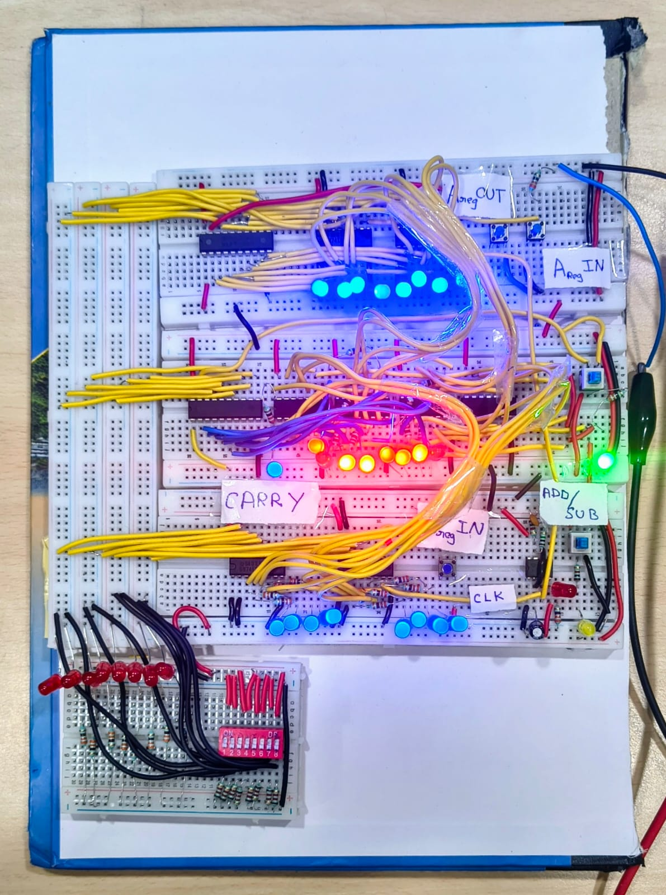
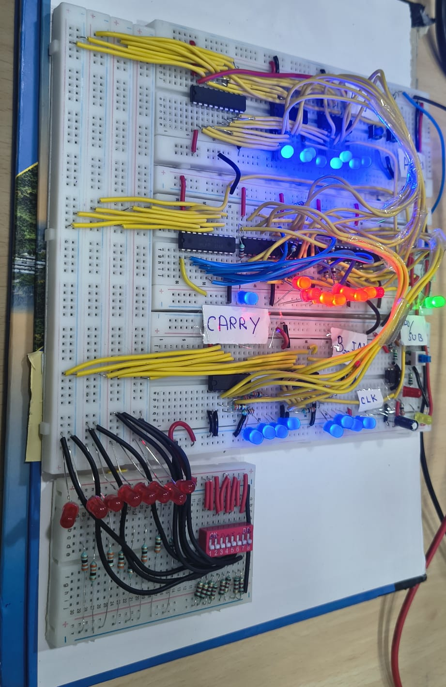

# ALUForge '26 — 8-Bit ALU Hardware Project

## Project Overview

This project focuses on implementing an **8-bit Arithmetic Logic Unit (ALU)** using digital logic hardware and an 8-bit register. The system is designed to perform addition and subtraction involving multiple variables, with intermediate results stored in a register for sequential computation.

Developed for the ALUForge '26 – 8-Bit ALU Hardware Hackathon, this project demonstrates practical digital logic design, hardware wiring, arithmetic computation, and testing.

## Objectives

- Design an 8-bit ALU using digital logic ICs.
- Perform addition and subtraction operations.
- Store intermediate results using an 8-bit register.
- Support sequential calculations involving multiple operands.
- Display binary values and results using LEDs.
- Understand register operations, data flow, and control signals.

## Hardware Components

- Digital logic ICs
- 8-bit register circuitry
- Breadboards
- Push buttons or switches
- LEDs and current-limiting resistors
- Jumper wires
- Power supply

## 🔌 ICs Required for the 8-Bit ALU

The following integrated circuits are used to implement the register storage, bus interfacing, arithmetic operations, subtraction logic, and clock generation.

| S.No. | IC Number | Quantity | Purpose |
|---:|---|---:|---|
| 1 | SN74LS173AN | 4 | 4-bit register ICs; two ICs per 8-bit operand register for storing A and B |
| 2 | SN74HCT245N | 2 | 8-bit bidirectional tri-state bus transceivers for data bus interfacing |
| 3 | SN74LS283N | 2 | 4-bit binary full adders; two ICs combine to perform 8-bit addition |
| 4 | SN74HC86N | 2 | Quad XOR gate ICs for conditional inversion of B during subtraction |
| 5 | NE555P | 1 | Generates an approximately 1 Hz clock signal for sequential operation |

### Total IC Count

**11 ICs** across five different IC types.

### Arithmetic Implementation

The two SN74LS283N ICs are cascaded to form an 8-bit adder. The SN74HC86N XOR gates conditionally invert the B operand during subtraction.

Using two's-complement arithmetic:

- **Addition:** A + B
- **Subtraction:** A + (~B) + 1

The carry-in and XOR control signals must be configured correctly to select between addition and subtraction.

### Register and Bus Architecture

The SN74LS173AN ICs provide 4-bit storage per IC, allowing two ICs to form each 8-bit register. Four ICs provide storage for the two 8-bit operands A and B.

The SN74HCT245N ICs provide tri-state bus interfacing to help control data transfers between circuit blocks.

The NE555P generates the clock signal, with the timing components selected for an approximately 1 Hz output.

*Note: Confirm the register enable, clear, output-enable, and bus-direction connections against the relevant datasheets before powering the circuit.*

## Working Principle

1. Set the input operands using switches or input controls.
2. Load the required value into the register.
3. Select addition or subtraction using the control signals.
4. The ALU performs the selected arithmetic operation.
5. Store the result in the register when required.
6. Reuse the stored result for subsequent calculations.
7. Observe the binary output through the LED indicators.

## Arithmetic Operations

| Operation | Function |
|---|---|
| Addition | A + B |
| Subtraction | A − B |
| Sequential addition | Accumulate results across multiple operands |
| Sequential subtraction | Use intermediate results for further subtraction |

## 📸 Hardware Implementation

### 8-Bit ALU — Hardware Overview

### Additional Circuit View

## Testing

Test the circuit using different binary inputs, including zero, maximum values, addition with carry, subtraction resulting in zero, and repeated operations using stored results.

## Learning Outcomes

- Digital logic circuit design
- 8-bit binary arithmetic
- Register-based data storage
- Arithmetic circuit testing and debugging
- Hardware implementation and troubleshooting

## Future Improvements

- Add logical operations such as AND, OR, and XOR.
- Implement carry, borrow, zero, and overflow indicators.
- Improve the input and output interface.
- Integrate the ALU into a basic processor datapath.

## Project Details

- **Event:** ALUForge '26 – 8-Bit ALU Hardware Hackathon
- **Project:** 8-Bit ALU

*Every Operation Builds a Brighter Tomorrow!*
